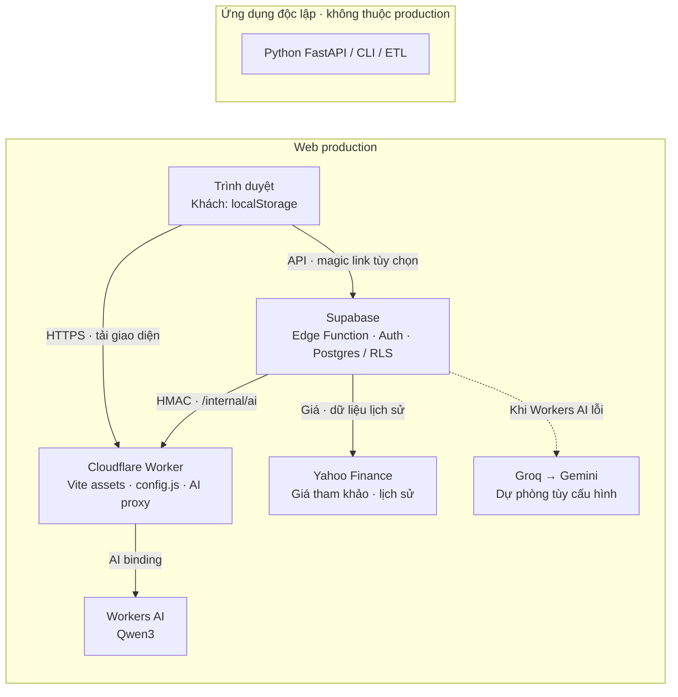

# Findata — Trợ lý tài chính

Findata là ứng dụng web tiếng Việt giúp tra cứu giá tham khảo cổ phiếu, xem
biểu đồ lịch sử và hỏi đáp kiến thức tài chính. Người dùng có thể dùng thử
ngay không cần đăng nhập; đăng nhập bằng magic link là tùy chọn để đồng bộ
phiên trò chuyện riêng tư.

**Ứng dụng production:** [ai-financial-assistant.nhattubut.workers.dev](https://ai-financial-assistant.nhattubut.workers.dev)

> Thông tin trên ứng dụng chỉ phục vụ mục đích tham khảo và giáo dục, không
> phải tư vấn đầu tư. Giá có thể trễ, thiếu hoặc thay đổi; hãy kiểm tra với
> nguồn dữ liệu và đơn vị được cấp phép trước khi ra quyết định.

## Ứng dụng web production

### Kiến trúc



Frontend được build bằng Vite và phục vụ từ Cloudflare Workers Static Assets.
Supabase Edge Function xử lý dữ liệu thị trường, câu hỏi, biểu đồ và các thao
tác lịch sử của tài khoản. Thư mục Python ở repository root là một ứng dụng
FastAPI/CLI riêng, **không** phải backend của website production và không được
Cloudflare Worker chạy. Sơ đồ tương tác được xuất bản riêng bằng GitHub Pages
tại [dartrint.github.io/AI-Financial-Assistant](https://dartrint.github.io/AI-Financial-Assistant/);
đây là trang tĩnh chỉ dành cho sơ đồ, không thay thế domain ứng dụng production.
Workflow tự triển khai lại khi sơ đồ hoặc cấu hình Pages thay đổi. Nếu trang
chưa được bật cho repository, vào **Settings → Pages**, chọn **GitHub Actions**
làm Build and deployment source. Bản xem tương tác trình bày luồng web,
xác thực/lịch sử, AI và ứng dụng Python riêng; nhãn sơ đồ dùng tiếng Việt,
còn điều khiển hiện dùng tiếng Anh.

### Tính năng và phạm vi dữ liệu

- Bảng giá tham khảo Yahoo Finance cho 15 mã: `VCB`, `BID`, `CTG`, `VNM`,
  `FPT`, `VIC`, `MSN`, `VJC`, `SAB`, `HPG`, `MWG`, `VRE`, `HDB`, `TCB`,
  `VPB`.
- Biểu đồ giá lịch sử theo các kỳ 1 tháng, 3 tháng, 6 tháng, 1 năm và 5 năm.
  Các kỳ đến 1 năm dùng dữ liệu ngày; kỳ 5 năm dùng dữ liệu tuần. Giá lịch sử
  chưa điều chỉnh cổ tức hoặc chia tách.
- Hỏi đáp kiến thức tài chính bằng tiếng Việt; khi cấu hình thành công,
  Cloudflare Workers AI với Qwen3 là nhà cung cấp chính, Groq và Gemini là
  phương án dự phòng.
- Dữ liệu và câu trả lời có thể không đầy đủ hoặc không cập nhật theo thời
  gian thực. Yahoo Finance không phải cam kết feed giao dịch realtime hay
  quyền sử dụng dữ liệu thương mại.

### Phiên trò chuyện và đăng nhập

- Khách có thể tạo, tìm, chuyển và xóa nhiều phiên mà không đăng nhập. Phiên
  khách được lưu trong `localStorage` trên trình duyệt hiện tại; mỗi phiên
  giữ tối đa 200 tin nhắn. Xóa dữ liệu trình duyệt có thể làm mất lịch sử này.
- Đăng nhập bằng magic link là tùy chọn. Tài khoản có thể đồng bộ danh sách
  tối đa 100 phiên mỗi lần tải; lịch sử được lưu trong Supabase và giới hạn
  theo tài khoản bằng Row Level Security (RLS). Khách không đọc hoặc ghi được
  lịch sử tài khoản.
- Supabase Auth phải cho phép URL Worker trong danh sách Redirect URLs.
  Kiểm tra Site URL và Redirect URLs trong phần Authentication của Supabase
  nếu magic link không quay lại ứng dụng.

### Giới hạn sử dụng

- Khách: tối đa 5 câu hỏi/phút và 15 yêu cầu biểu đồ/phút theo IP.
- Tài khoản: tối đa 10 câu hỏi/phút.
- Giới hạn khách hiện dùng bộ nhớ của Edge Function và chỉ có tính best-effort
  theo từng instance; đây chưa phải bộ giới hạn bền vững cho lưu lượng lớn.
- Giá thị trường được cache ngắn hạn; dữ liệu lịch sử biểu đồ được cache trong
  Edge Function. Cache không đảm bảo độ mới hay tính sẵn sàng của nguồn.

## Phát triển và deploy website

### Yêu cầu

- Node.js và npm tương thích với phiên bản Wrangler khai báo trong
  `package.json`.
- Tài khoản Cloudflare có Workers AI và quyền deploy Workers.
- Tài khoản Supabase có quyền áp dụng migrations, quản lý Edge Function và
  Auth settings.

### Chạy frontend tại local

```bash
npm ci
npm run dev
```

Vite phục vụ frontend; các biến cấu hình public của Supabase được Worker cấp
qua `/config.js` từ `wrangler.toml`. Để chạy các endpoint Supabase local hoặc
thử nhà cung cấp AI dự phòng, cài và chạy Supabase CLI theo tài liệu Supabase,
đồng thời thiết lập secrets phù hợp cho môi trường đó.

### Build và deploy Cloudflare Worker

```bash
npm ci
npm run build
npx wrangler login
npm run deploy
```

Các scripts `dev`, `build` và `deploy` được khai báo trong `package.json`.
`wrangler.toml` cấu hình Worker tên `ai-financial-assistant`, thư mục static
assets `dist`, binding Workers AI và biến public cần cho frontend. Không đưa
secret vào `[vars]`, mã nguồn hoặc frontend.

Website hiện chạy trên Workers, không phải Cloudflare Pages. Nếu kết nối GitHub
qua Workers Builds, dùng thư mục gốc của repository, nhánh production `master`,
để trống Build command và dùng Deploy command `npm run deploy`. Không cấu hình
Pages Builds chạy `pip install -r requirements.txt` cho website này.

### Cấu hình Workers AI và nhà cung cấp dự phòng

Worker gọi Workers AI qua endpoint nội bộ `/internal/ai`; endpoint yêu cầu chữ
ký HMAC để chỉ Edge Function được cấu hình mới gọi được.

1. Tạo một secret ngẫu nhiên riêng, tối thiểu 32 ký tự.
2. Đặt `AI_PROXY_SECRET` trong **Cloudflare Dashboard → Workers & Pages →
   Worker → Settings → Variables and Secrets**.
3. Đặt cùng secret đó trong **Supabase Dashboard → Edge Functions → Secrets**
   với tên `CF_AI_PROXY_SECRET`.
4. Trong Supabase Edge Function Secrets, đặt `CF_AI_PROXY_URL` thành URL HTTPS
   của Worker kết thúc bằng `/internal/ai`, ví dụ
   `https://<worker-domain>/internal/ai`.
5. Deploy lại Worker và Edge Function sau khi cấu hình.

Không gửi các secrets này cho trình duyệt, không commit chúng và không dùng
Supabase secret/service-role key thay thế. Khi hết quota Workers AI hoặc nhà
cung cấp chính không sẵn sàng, function thử Groq rồi Gemini nếu đã cấu hình
`GROQ_API_KEY` hoặc `GEMINI_API_KEY`. Có thể đặt `GROQ_MODEL` và
`GEMINI_MODEL`; khi không có nhà cung cấp hoạt động, API trả lỗi thay vì câu
trả lời giả lập.

### Cấu hình Supabase

Project reference hiện dùng cho website được cấu hình trong `wrangler.toml`.
Để liên kết CLI với project đó, đăng nhập bằng tài khoản có quyền truy cập rồi
áp dụng migrations và deploy function:

```bash
npx supabase login
npx supabase link --project-ref <project-ref>
npx supabase db push
npx supabase functions deploy financial-assistant --no-verify-jwt
```

Thay `<project-ref>` bằng project reference của môi trường đang triển khai.
`--no-verify-jwt` cần thiết vì function cho phép khách chưa đăng nhập; function
tự xác thực JWT của tài khoản khi có. Migrations trong
[`supabase/migrations/`](./supabase/migrations/) tạo bảng tin nhắn, bảng phiên,
RLS và quan hệ giữa lịch sử với phiên. Phải áp dụng migrations trước khi
deploy phiên bản function sử dụng schema đó.

Các biến public `SUPABASE_URL` và `SUPABASE_PUBLISHABLE_KEY` được cấp cho
frontend từ cấu hình Worker. Publishable key được thiết kế để dùng ở client
với RLS; không đặt `SUPABASE_SECRET_KEY` hoặc service-role key ở frontend hay
trong cấu hình public của Worker. Edge Function của Supabase sử dụng cơ chế
xác thực được cung cấp bởi `@supabase/server`.

## Ứng dụng Python độc lập (tùy chọn)

Repository còn có FastAPI, CLI và mã ETL/RAG Python cho các thử nghiệm độc lập.
Đây không phải luồng chạy hoặc deploy của website Cloudflare/Supabase. Cài
các dependency Python có thể phụ thuộc vào phiên bản Python và khả năng truy
cập package `vnstock` trong môi trường của bạn:

```bash
python -m venv .venv
# Windows PowerShell:
.venv\Scripts\Activate.ps1
python -m pip install -r requirements.txt
uvicorn app:app --reload
```

CLI:

```bash
python main.py --question "P/E của FPT hiện tại là bao nhiêu?"
python main.py --interactive
```

ETL có các nguồn và chế độ được hỗ trợ riêng trong mã nguồn; xem
`python -m etl.run_etl --help` trước khi chạy vì thao tác có thể tải dữ liệu
web và ghi vector store cục bộ.

## Bảo mật và quyền riêng tư

- Chỉ cấu hình credentials trong secret manager của dịch vụ tương ứng hoặc
  file môi trường local không được commit.
- Không gửi access token, service-role/secret key hoặc khóa nhà cung cấp AI
  tới client.
- Lịch sử tài khoản là dữ liệu riêng tư; phiên khách nằm trong trình duyệt
  của người dùng và không được đồng bộ tự động.

## Giấy phép và lưu ý

Hãy xác minh điều khoản sử dụng của từng nguồn dữ liệu, dịch vụ AI và nội dung
ETL trước khi phân phối hoặc sử dụng thương mại. Ứng dụng không đảm bảo tính
chính xác, đầy đủ, kịp thời hoặc phù hợp của thông tin cho một quyết định đầu
tư cụ thể.
