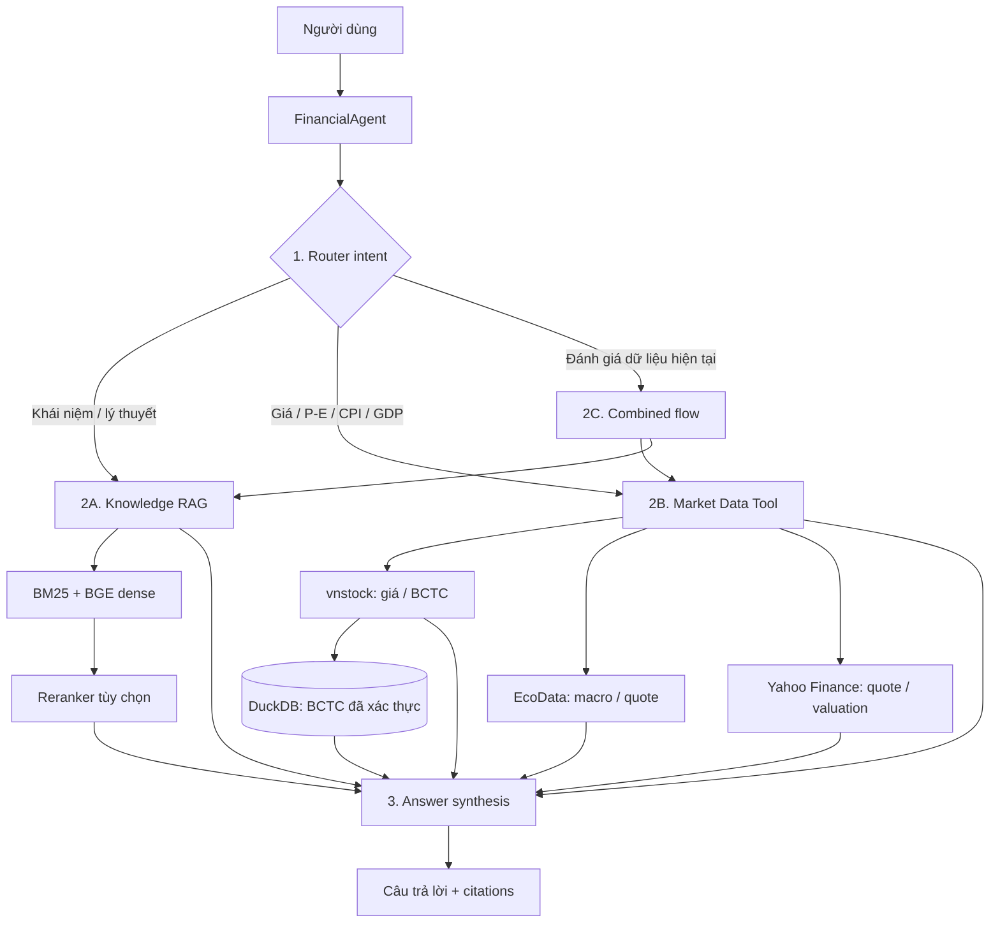

# AI Financial Assistant

Trợ lý tài chính tiếng Việt với ba đường xử lý tách biệt: dữ liệu thị trường thời gian thực, tri thức nền tảng RAG, và phân tích kết hợp. Dữ liệu thay đổi theo thị trường không được đưa vào Vector Database.

## Kiến trúc



### Quy tắc định tuyến

| Câu hỏi | Đường xử lý |
| --- | --- |
| `GDP là gì?`, `CAPM hoạt động ra sao?` | Knowledge RAG |
| `P/E của FPT hiện tại là bao nhiêu?`, `CPI Việt Nam hiện tại?` | Market Data Tool |
| `P/E FPT hiện tại cao hay thấp?` | Market Data Tool + RAG context |
| `Doanh thu VNM 2024?` | Financial-statement analysis |

## Cấu trúc mã nguồn

```text
agent.py                 Router và 5 bước orchestration
market_data/             Adapters vnstock, EcoData, Yahoo, DuckDB
knowledge/               Collections, seed documents, Qdrant store
retrieval/               BM25, BGE dense retrieval, reranker, hybrid fusion
tools/                   Market data, concept, statement, economic, portfolio tools
etl/                     Extract → transform → chunk → metadata → Qdrant load
app.py                   FastAPI API và khởi tạo các layer
main.py                  CLI dùng chung aggregator + FinancialAgent
tests/                   Unit tests cho routing và citation
```

## Luồng thực thi

1. `FinancialAgent.answer()` phân loại intent trước khi truy cập dữ liệu.
2. Trích xuất ticker, năm và metric bằng parser deterministic; LLM là tùy chọn.
3. Chọn một tool theo intent để giữ ranh giới giữa dữ liệu live và RAG.
4. Tool trả về dữ liệu, phép tính, context và citation có cấu trúc.
5. LLM chỉ được phép diễn đạt lại kết quả phân tích BCTC đã có số liệu; không
   được suy đoán dữ liệu mới.

## Chạy dự án

```bash
pip install -r requirements.txt
uvicorn app:app --reload
# hoặc
python main.py --question "P/E của FPT hiện tại là bao nhiêu?"
```

## Deploy Cloudflare frontend + Supabase backend

Ứng dụng web dùng Cloudflare Workers Static Assets cho frontend và Supabase
Edge Functions cho API. Khách có thể xem giá cổ phiếu và hỏi trợ lý mà không
cần tạo tài khoản; đăng nhập magic link chỉ là tùy chọn để lưu lịch sử chat
riêng trong Postgres. FastAPI/Python vẫn dùng được khi chạy riêng, nhưng không
phải backend của bản web này.

### 1. Tạo Supabase backend

Project Supabase hiện tại được cấu hình trong `wrangler.toml`. Đăng nhập Supabase
CLI, liên kết project và áp dụng schema:

```bash
npx supabase login
npx supabase link --project-ref ownfdfumbymfqfacyhfw
npx supabase db push
npx supabase functions deploy financial-assistant --no-verify-jwt
```

The Edge Function accepts either a validated signed-in user or a guest. User
JWT validation and per-user history access are handled by `@supabase/server`;
guest requests cannot read or write the private chat history.

Cloudflare Workers AI với Qwen3 30B là model chính. Trong **Cloudflare Workers
& Pages > Workers > Settings > Variables and Secrets**, đặt secret
`AI_PROXY_SECRET` (ít nhất 32 ký tự). Trong **Supabase Dashboard > Edge
Functions > Secrets**, đặt `CF_AI_PROXY_URL` thành URL Worker kết thúc bằng
`/internal/ai` và đặt `CF_AI_PROXY_SECRET` cùng giá trị. Worker xác thực yêu
cầu gọi model bằng HMAC; không đưa secret này vào frontend hoặc repository.
Tạo một giá trị ngẫu nhiên mới cho secret, nhập cùng giá trị vào hai dashboard,
rồi deploy lại Worker và Edge Function. Không dùng publishable key, JWT hoặc
Supabase service-role key làm secret này.

Workers AI có quota miễn phí 10.000 Neurons/ngày dùng chung trong tài khoản
Cloudflare; khi hết quota, app thử Groq rồi Gemini nếu đã cấu hình các secret
`GROQ_API_KEY` hoặc `GEMINI_API_KEY`. Có thể đặt `GROQ_MODEL` và
`GEMINI_MODEL`; không cấu hình secret nào thì ứng dụng báo AI tạm thời không
sẵn sàng. Không đặt `SUPABASE_SECRET_KEY` trong frontend hoặc Cloudflare vars.

Nếu muốn bật lưu lịch sử bằng magic link, thêm URL Worker vào **Authentication >
URL Configuration > Redirect URLs** của Supabase.

### 2. Deploy frontend lên Cloudflare Workers

Đăng nhập Wrangler, bật subdomain `workers.dev` cho tài khoản nếu chưa bật, rồi
deploy:

```bash
npm ci
npx wrangler login
npm run deploy
```

Worker được cấu hình `workers_dev = true`, nên URL sẽ có dạng
`https://ai-financial-assistant.<account-subdomain>.workers.dev`.

Để deploy tự động khi push lên GitHub, kết nối repository tại **Workers & Pages
> Workers Builds** (không phải Pages Builds), production branch `master`, root
directory là gốc repository, để trống Build command và đặt Deploy command thành
`npm run deploy`. Pages Builds cài `requirements.txt` cho ứng dụng Python nên
không phù hợp để build Worker này.

### Phạm vi ứng dụng web

- Bảng giá tham khảo cho 15 mã cổ phiếu qua Yahoo Finance; API được cache trong
  bộ nhớ Edge Function khoảng 60 giây. Thời điểm hiển thị là thời điểm dữ liệu
  do nhà cung cấp trả về, không phải thời điểm tải trang.
- Yahoo Finance không phải nguồn cấp dữ liệu giao dịch realtime được bảo đảm.
  Feed có thể trễ, thiếu hoặc thay đổi; hãy xác minh quyền sử dụng/hiển thị
  thương mại trước khi mở rộng ra sản phẩm công khai.
- Câu hỏi khái niệm được Qwen3 trên Cloudflare Workers AI trả lời bằng Markdown;
  Groq/Gemini là phương án dự phòng tùy secret. Câu hỏi về giá dùng báo giá đã
  lấy từ Yahoo Finance. Biểu đồ so sánh chỉ dùng hai mốc phiên trước và gần nhất
  khi nguồn có đủ dữ liệu; không phải chuỗi lịch sử. P/E, P/B, báo cáo doanh
  nghiệp và các mã ngoài watchlist chưa được hỗ trợ.
- Khách không cần đăng nhập; hội thoại khách chỉ ở trong trang hiện tại và
  không được lưu. Giới hạn khách 5 câu hỏi/phút/IP là best-effort theo Edge
  instance, không thay thế một rate limiter bền vững khi có lượng truy cập lớn.
- Magic-link login là tùy chọn. Khi đăng nhập, RLS trong Postgres giới hạn lịch
  sử chat cho đúng tài khoản và giới hạn tài khoản là 10 câu hỏi/phút.
- Để chạy FastAPI đầy đủ tại local, dùng các lệnh Python ở trên. Python backend
  hiện chưa được port sang Supabase Edge Functions.

Chạy frontend Worker local sau khi cài dependencies:

```bash
npm ci
npm run dev
```

FastAPI local environment variables:

- `GROQ_API_KEY`, `GROQ_MODEL` — LLM Groq; `QROQ_*` cũ vẫn tương thích.
- `ECODATA_API_KEY`, `ECODATA_MACRO_PATH`, `ECODATA_QUOTE_PATH` — dữ liệu
  macro/quote EcoData, tùy theo endpoint của gói dịch vụ.
- `BGE_MODEL` — mặc định `BAAI/bge-small-en-v1.5`.

## ETL tri thức

```bash
python -m etl.run_etl --list
python -m etl.run_etl --source investopedia_financial --limit 20
```

ETL chỉ lấy URL được cấu hình hoặc phát hiện từ sitemap; sau đó làm sạch bằng Trafilatura/BeautifulSoup, chunk 800 ký tự với overlap 150 và ghi metadata
`topic`, `category`, `difficulty`, `source`, `updated_at` vào Qdrant.
