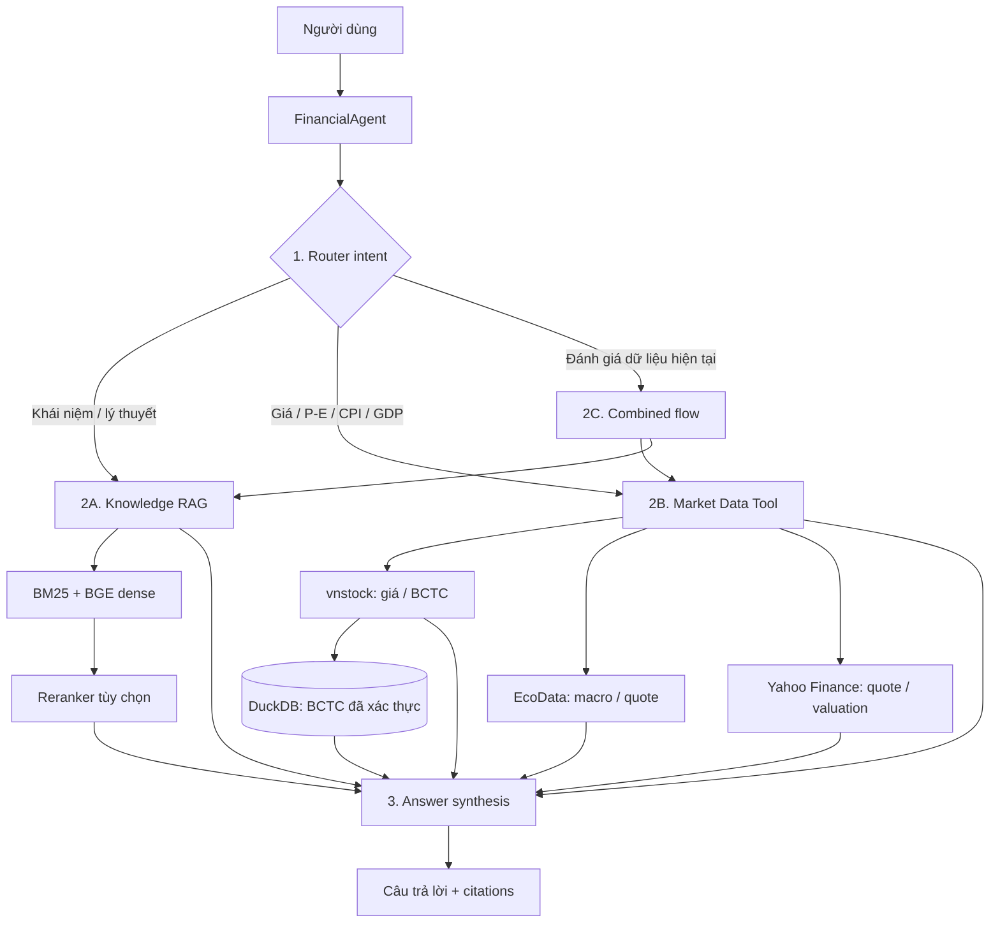

# AI Financial Assistant

Trợ lý tài chính tiếng Việt với ba đường xử lý tách biệt: dữ liệu thị trường thời gian thực, tri thức nền tảng RAG, và phân tích kết hợp. Dữ liệu thay đổi theo thị trường không được đưa vào Vector Database.

## Kiến trúc



### Quy tắc định tuyến

| Câu hỏi | Đường xử lý |
| --- | --- |
| `GDP là gì?`, `CAPM hoạt động ra sao?` | Knowledge RAG |
| `P/E của FPT hiện tại là bao nhiêu?`, `CPI Việt Nam hiện tại?` | Market Data Tool |
| `P/E FPT hiện tại cao hay thấp?` | Market Data Tool + RAG context |
| `Doanh thu VNM 2024?` | Financial-statement analysis |

## Cấu trúc mã nguồn

```text
agent.py                 Router và 5 bước orchestration
market_data/             Adapters vnstock, EcoData, Yahoo, DuckDB
knowledge/               Collections, seed documents, Qdrant store
retrieval/               BM25, BGE dense retrieval, reranker, hybrid fusion
tools/                   Market data, concept, statement, economic, portfolio tools
etl/                     Extract → transform → chunk → metadata → Qdrant load
app.py                   FastAPI API và khởi tạo các layer
main.py                  CLI dùng chung aggregator + FinancialAgent
tests/                   Unit tests cho routing và citation
```

## Luồng thực thi

1. `FinancialAgent.answer()` phân loại intent trước khi truy cập dữ liệu.
2. Trích xuất ticker, năm và metric bằng parser deterministic; LLM là tùy chọn.
3. Chọn một tool theo intent để giữ ranh giới giữa dữ liệu live và RAG.
4. Tool trả về dữ liệu, phép tính, context và citation có cấu trúc.
5. LLM chỉ được phép diễn đạt lại kết quả phân tích BCTC đã có số liệu; không
   được suy đoán dữ liệu mới.

## Chạy dự án

```bash
pip install -r requirements.txt
uvicorn app:app --reload
# hoặc
python main.py --question "P/E của FPT hiện tại là bao nhiêu?"
```

## Deploy Cloudflare frontend + Supabase backend

Ứng dụng web production dùng Cloudflare Workers Static Assets cho frontend và
Supabase Auth, Edge Functions, Postgres cho backend. FastAPI/Python vẫn dùng
được khi chạy riêng, nhưng không phải backend của bản Edge MVP này.

### 1. Tạo Supabase backend

Project Supabase hiện tại được cấu hình trong `wrangler.toml`. Đăng nhập Supabase
CLI, liên kết project và áp dụng schema:

```bash
npx supabase login
npx supabase link --project-ref ownfdfumbymfqfacyhfw
npx supabase db push
npx supabase functions deploy financial-assistant
```

Trong **Supabase Dashboard > Edge Functions > Secrets**, thêm ít nhất một khóa
LLM: `GROQ_API_KEY` hoặc `GEMINI_API_KEY`. Có thể đặt thêm `GROQ_MODEL` và
`GEMINI_MODEL`; function dùng model mặc định nếu bỏ trống. Không đặt
`SUPABASE_SECRET_KEY` trong frontend hoặc Cloudflare vars.

Sau khi Worker có URL `workers.dev`, thêm chính xác URL đó vào **Authentication >
URL Configuration > Redirect URLs** của Supabase để magic link quay lại ứng
dụng.

### 2. Deploy frontend lên Cloudflare Workers

Đăng nhập Wrangler, bật subdomain `workers.dev` cho tài khoản nếu chưa bật, rồi
deploy:

```bash
npm ci
npx wrangler login
npm run deploy
```

Worker được cấu hình `workers_dev = true`, nên URL sẽ có dạng
`https://ai-financial-assistant.<account-subdomain>.workers.dev`.

Để deploy tự động khi push lên GitHub, kết nối repository tại **Workers & Pages
> Workers Builds** (không phải Pages Builds), production branch `master`, root
directory là gốc repository, để trống Build command và đặt Deploy command thành
`npm run deploy`. Pages Builds cài `requirements.txt` cho ứng dụng Python nên
không phù hợp để build Worker này.

### Phạm vi Edge MVP

- Magic-link login qua Supabase Auth.
- Lịch sử chat lưu trong Postgres; RLS giới hạn mỗi tài khoản chỉ đọc/ghi lịch
  sử của chính mình.
- Edge Function yêu cầu JWT, giới hạn 10 câu hỏi/phút/tài khoản và gọi Groq hoặc
  Gemini cho câu hỏi khái niệm.
- Dữ liệu giá, P/E và báo cáo doanh nghiệp chưa được kết nối vào Edge Function;
  các câu hỏi cần số liệu sẽ bị từ chối thay vì bịa số liệu.
- Để chạy FastAPI đầy đủ tại local, dùng các lệnh Python ở trên. Python backend
  hiện chưa được port sang Supabase Edge Functions.

Chạy frontend Worker local sau khi cài dependencies:

```bash
npm ci
npm run dev
```

FastAPI local environment variables:

- `GROQ_API_KEY`, `GROQ_MODEL` — LLM Groq; `QROQ_*` cũ vẫn tương thích.
- `ECODATA_API_KEY`, `ECODATA_MACRO_PATH`, `ECODATA_QUOTE_PATH` — dữ liệu
  macro/quote EcoData, tùy theo endpoint của gói dịch vụ.
- `BGE_MODEL` — mặc định `BAAI/bge-small-en-v1.5`.

## ETL tri thức

```bash
python -m etl.run_etl --list
python -m etl.run_etl --source investopedia_financial --limit 20
```

ETL chỉ lấy URL được cấu hình hoặc phát hiện từ sitemap; sau đó làm sạch bằng Trafilatura/BeautifulSoup, chunk 800 ký tự với overlap 150 và ghi metadata
`topic`, `category`, `difficulty`, `source`, `updated_at` vào Qdrant.
